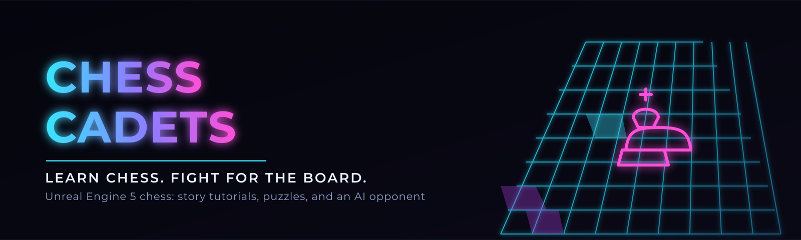
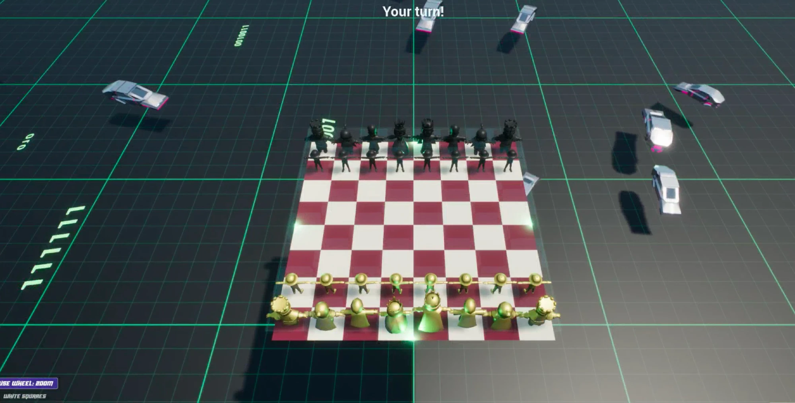
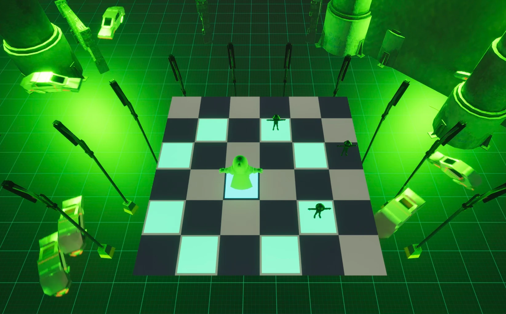
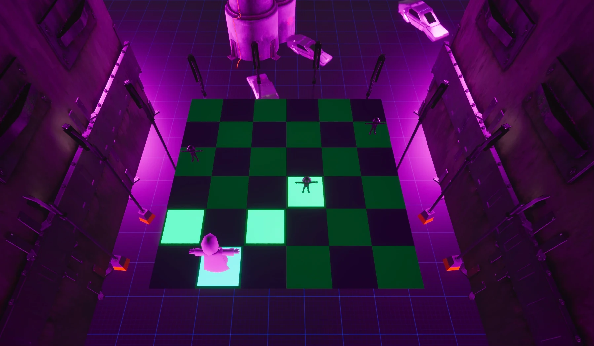
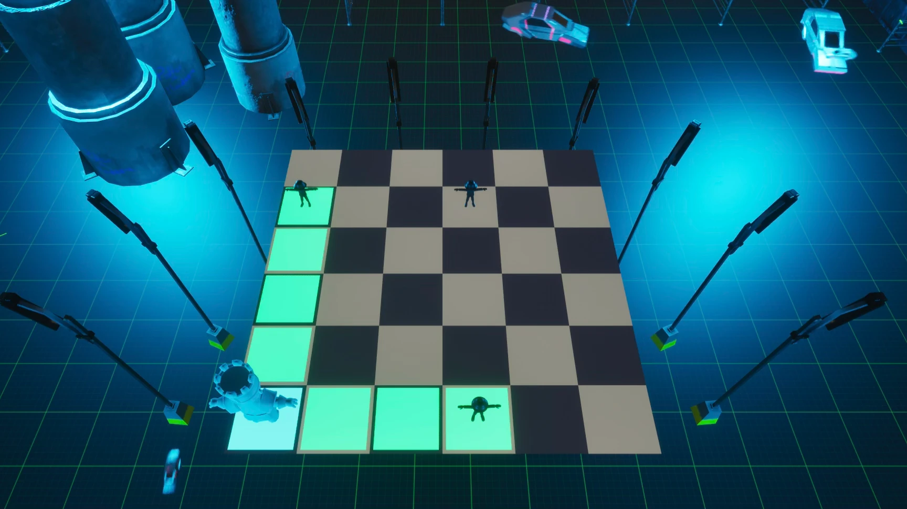
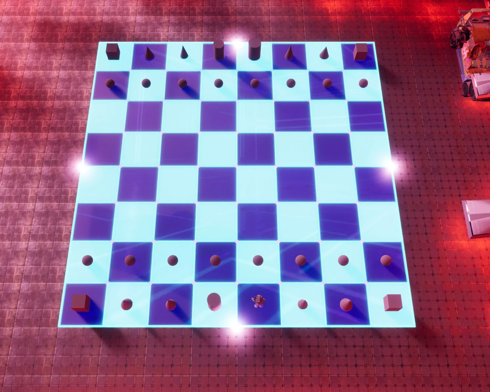
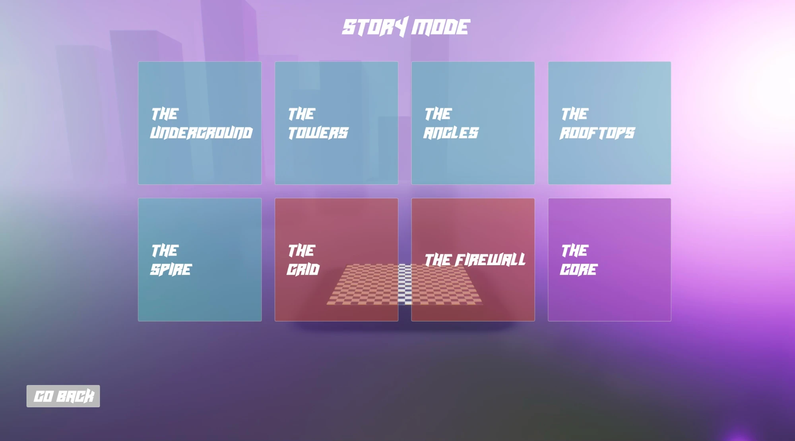
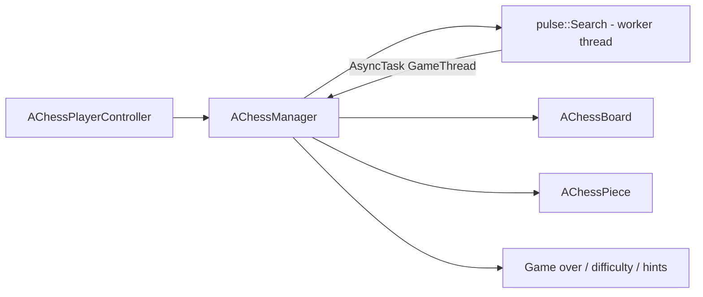

A chess game for kids, set in neon arenas, with a real search-based AI opponent behind the tutorials.

Chess Cadets (working title ChessKids) was our UCF senior design capstone. This is my copy of the
[team repository](https://github.com/LeineckerGames/ChessCadets), kept up to date with its final code, with
screenshots of the finished game and a write-up of how it works.

  

  
  

  
  

  

## What it does

Chess Cadets teaches a kid to play real chess. There's a tutorial for every piece, a puzzle mode, and five
holographic arenas to play full games in, against a friend or the built-in AI.

- **Full chess rules.** Castling on both sides, en passant, promotion, check, checkmate, stalemate, the 50-move
  rule, insufficient material and true threefold repetition, all enforced by the embedded Pulse engine
  (`Source/ChessKids/Engine/`).
- **An AI opponent that actually searches** instead of following a script. See "How the AI works" below.
- **Three difficulty levels** mapped to search depth: Easy (depth 1, and half the time it just plays a random legal
  move so young players can win), Medium (depth 3) and Hard (depth 6).
- **A tutorial for each piece.** One lesson class per piece (`PawnTutorial` through `KingTutorial`, plus
  `CheckmateTutorial`) walks the player through how it moves and captures on its own scripted board, unlocked in
  order by `TutorialManager`.
- **Puzzle mode.** `PuzzleManager` loads FEN positions and solution moves from a data table, castling puzzles
  included.
- **Five arenas and a story hub**, one per piece, picked from `LevelSelectMenuWidget`.
- **Piece skins** you unlock and preview live (`ChessPieceSkinRegistry`, `PieceSkinsMenuWidget`).
- **Save data** for unlocked skins and story progress (`UChessKidsSaveGame`).
- **Voice-over narration** for the tutorials, generated with ElevenLabs by the pipeline in `Tools/` and played by
  `ChessVoice`.

## My part

I wrote about 37% of the team's code (not counting the vendored Pulse engine or generated files). My parts:

- The Pulse-to-Unreal integration: swapping Pulse's threading for Unreal's (`search.h`/`search.cpp`), the
  `AChessManager` bridge, the difficulty mapping, the Easy-mode random move and the real threefold repetition check.
- Most of the core gameplay actors: `ChessBoard`, `ChessPiece`, `ChessCamera` and `ChessVoice`.
- About half of the work on the arena maps, plus the editor scripts that build and decorate them.
- The settings, pause and mode-select menus, and the castling puzzle mode.
- The voice lines and the ElevenLabs tooling that generates and normalizes them.

Mark ([@MarkMango21](https://github.com/MarkMango21)) brought the Pulse engine into the project. The rest of the
team built the tutorial ladder, the puzzle system, the piece skins, and more of the UI and gameplay.

## How the AI works

The search itself is the third-party **Pulse chess engine by Phokham Nonava** (MIT license), vendored into `Source/ChessKids/Engine/`. Pulse gives the project:

- Board state as 0x88 mailbox plus per-piece bitboards, with incremental Zobrist hashing (`position.h`, `position.cpp`).
- Iterative deepening from depth 1 up to the requested search depth (`search.cpp:238`).
- Negamax alpha-beta search with fail-soft cutoffs (`Search::search`, `search.cpp:325-366`).
- Quiescence search at the horizon so captures aren't evaluated mid-exchange (`Search::quiescent`, `search.cpp:369-408`).
- MVV-LVA move ordering (`MoveList::rateFromMVVLVA`, `movelist.cpp:39`, invoked from `movegenerator.cpp:58`).
- Checkmate and stalemate resolved inside the search itself: no legal reply plus check means mate (`-value::CHECKMATE + ply`), no legal reply without check means a draw.
- Draw detection mid-search on repetition, insufficient material, or the 50-move counter (`search.cpp:335`).

Pulse does **not** use a transposition table in this build; only Zobrist keys for repetition/draw checks.

What we built on top of Pulse:

- **Threading.** Pulse's own concurrency primitives were replaced with Unreal's `HAL` threading (`FRunnableThread`, `FCriticalSection`, `FEvent`) directly inside `search.h`/`search.cpp`, so the search runs on its own worker thread instead of blocking the game thread.
- **The Unreal bridge.** `AChessManager` (`Source/ChessKids/Private/ChessManager.cpp`) owns a `pulse::Search` instance behind a small `Protocol` implementation (`FEngineImpl`, `ChessManager.cpp:35`). When Pulse's search thread calls back with a move, the callback hops back to the game thread with `AsyncTask(ENamedThreads::GameThread, ...)` (`ChessManager.cpp:324`) before touching any Unreal object.
- **Difficulty mapping.** `AChessManager::SetDifficulty` maps the three difficulty levels to search depths 1/3/6 (`ChessManager.cpp:651-665`).
- **The Easy-mode random move.** At depth 1, `RequestAIMove` rolls a 50/50 chance to just play a random legal move instead of asking Pulse for one, so new players can actually win a game (`ChessManager.cpp:410-437`).
- **True threefold repetition for game-over.** Pulse's own `isRepetition()` returns on the *first* repeat, a common engine shortcut used only inside the search to prune early. The team added a separate `Position::isThreefoldRepetition()` (`position.cpp:169`) that counts to a real third occurrence, and wired it into `AChessManager::CheckGameOver` (`ChessManager.cpp:954`) so the UI only calls a real draw, not the search's internal heuristic.
- **Hints.** `RequestHint` runs a quick depth-4 search and reports the move back without playing it (`ChessManager.cpp:460`).

## Architecture

| Class | Role |
|---|---|
| `AChessPlayerController` | Reads player input, forwards moves to `AChessManager` |
| `AChessManager` | Owns the Pulse engine instance, board state, turn flow, difficulty, game-over detection |
| `pulse::Search` | The AI search, on its own worker thread |
| `AChessBoard` / `AChessPiece` | Visual board and piece actors, driven by `AChessManager` |
| `ATutorialManager` + per-piece tutorial classes | The lesson ladder |
| `APuzzleManager` | Puzzle mode (FEN + solution move data table) |
| `UChessKidsGameInstance` | Cross-level state: difficulty, save data, selected skin |
| `UChessKidsSaveGame` | Persisted skin unlocks and story progress |
| `AChessVoice` | Plays VO clips looked up by ID from `VoiceLineMap.gen.h` |

## Build and play

It's an Unreal Engine 5.7 project, built with Visual Studio 2022 on Windows.

1. Install UE 5.7 and VS 2022 with the "Game development with C++" workload.
2. Clone the repository with Git LFS installed. The Unreal assets in `Content/` are stored in LFS.
3. Right-click `ChessKids.uproject` and choose "Generate Visual Studio project files".
4. Open the solution and build the `ChessKidsEditor` target, or open `ChessKids.uproject` and let the editor build it.

The third-party marketplace packs (CyberpunkIndustries, Fab and NaturePack) and the two display fonts aren't in this
copy, because their licenses don't allow it, so the arenas will be missing the scenery that came from them.
Everything else is here: the code, the maps, the UI, and the music, sound effects and voice lines, which the team
made in-house with AI tools.

For working on the project (adding arenas, scripting tutorial levels, the voice-over pipeline, branch workflow),
see the team's [developer guide](Docs/DEVELOPMENT.md).

## Python tooling

`Tools/` drives the Unreal Editor over its Python Remote Execution API, plus a standalone voice-over pipeline. See `Tools/README.md` for the full rundown; short version:

- `ue_remote.py`: the driver. Discovers a running editor instance and sends it a `.py` file to execute, relaying `print()` output back to the terminal.
- `board_diag.py`: read-only dump of a `ChessBoard` actor's material slots, for debugging holographic overlay/glow issues.
- `build_chess_maps.py`: bootstraps the five piece-arena map skeletons.
- `decorate_maps.py`: procedural cyberpunk decoration pass (neon trim, pylons, point lights) over the arena maps.
- `fix_board_materials.py` / `fix_boards.py`: one-off repair passes for board material wiring.
- `generate_vo.py`: synthesizes missing voice-over clips through the ElevenLabs API and can emit the C++ lookup table (`--emit-cpp`, writes `Source/ChessKids/Private/VoiceLineMap.gen.h`). The API key comes from `ELEVENLABS_API_KEY` in a repo-root `.env` (gitignored) or the environment, never hardcoded.
- `normalize_vo.py`: loudness-normalizes generated clips to a common RMS level so different ElevenLabs voices don't play back at wildly different volumes.
- `vo_audit.py`: cross-references tutorial dialogue strings against the VO manifest and flags lines with no matching clip.
- `generate_textures.py` (repo root): generates the holographic/cyberpunk chess textures with Pillow.

## Team and credits

Built by a UCF senior design team: Gabriel Parra ([@gabeparra](https://github.com/gabeparra)), Mark
([@MarkMango21](https://github.com/MarkMango21)), Andrew Stoumbos ([@AndrewStoumbos](https://github.com/AndrewStoumbos)),
Isabella Spanyol ([@isabellaspanyol](https://github.com/isabellaspanyol)) and Marco Saavedra Fernandez.

The chess engine in `Source/ChessKids/Engine/` is the [Pulse chess engine](https://github.com/fluxroot/pulse) by
Phokham Nonava (MIT), adapted for Unreal's threading. The animated character was made with Meshy AI.

## License

MIT. See [LICENSE](LICENSE). Pulse keeps its own MIT copyright notice (Phokham Nonava, 2013-2023).
